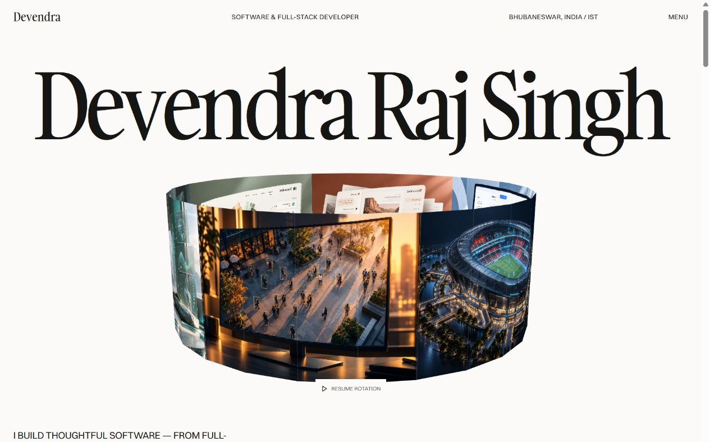
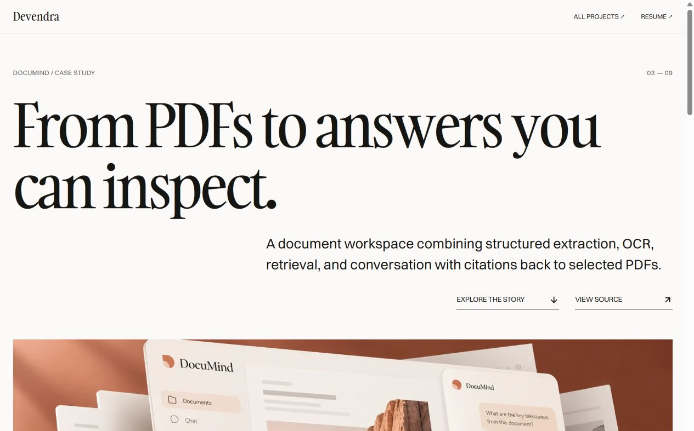
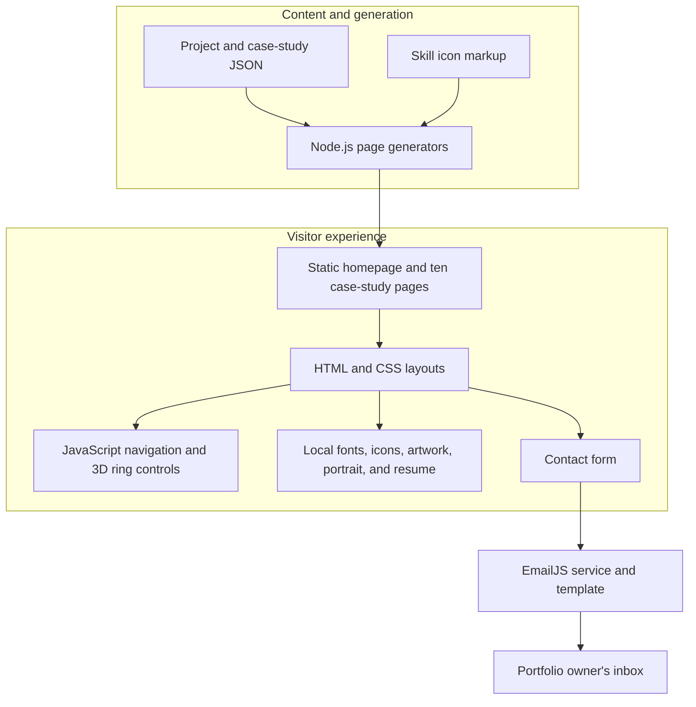

<div align="center">

# Devendra Raj Singh

### Software. Systems. The stories behind the build.

A personal portfolio for full-stack development, AI projects, and hands-on engineering.

[](index.html)
[](portfolio.css)
[](portfolio.js)
[](preview-server.cjs)
[](#contact)

<br />



<br />

**[Overview](#overview)** · **[Projects](#projects)** · **[Architecture](#architecture)** · **[Run locally](#quick-start)** · **[Customize](#customize)** · **[Deploy](#deployment)**

[Resume PDF](output/pdf/Devendra_Raj_Singh_Resume.pdf) · [GitHub](https://github.com/devendrarajsingh07) · [LinkedIn](https://www.linkedin.com/in/devendra-raj-singh-b118b3212/)

</div>

---

<a id="overview"></a>

## ✦ At a glance

This portfolio presents the work of **Devendra Raj Singh**, a Computer Science student at **KIIT, Bhubaneswar**, focused on software and full-stack development.

The experience pairs a light editorial layout with an interactive image cylinder, a visual project gallery, and **ten dedicated case studies**. Each story goes beyond a stack list to explain the problem, approach, technical decisions, tradeoffs, and current scope.

| Explore | What you will find |
| --- | --- |
| **10 project stories** | Full-stack applications, document intelligence, reporting systems, digital twins, computer vision, reinforcement learning, and desktop software. |
| **36 skill badges** | Technology icons grouped by languages, frontend, backend, AI, databases, and tools. |
| **Experience & education** | Internships, E-Labs training, KAEWS Operations Lead, and KIIT CSE, 2024–2028. |
| **Resume & contact** | A one-page PDF with clickable profile links, plus a working EmailJS contact form. |

<a id="features"></a>

## ✨ The experience

| Feature | Implementation |
| --- | --- |
| **Open 3D image cylinder** | CSS perspective and two-sided image panels with automatic rotation, pointer drag, arrow-key control, and pause/resume. |
| **Full-screen navigation** | A dark menu with keyboard focus handling, Escape to close, and an inert background. |
| **Project gallery** | Six featured project covers, four additional project rows, and separate case-study and repository actions. |
| **Case-study reader** | Shared editorial layouts, five story sections, three technical decisions per project, source links, and a ten-project navigation loop. |
| **Responsive layout** | A two-column desktop gallery, stacked mobile content, and a smaller interactive cylinder. |
| **Motion preferences** | Automatic rotation pauses offscreen, when the page is hidden, and for reduced-motion preferences. |
| **Developer playground** | A separate terminal-style resume experience. |
| **Static delivery** | Plain HTML, CSS, and JavaScript with local fonts and optimized WebP project artwork. |

<details>
<summary><strong>Preview a case-study page</strong></summary>

<br />



The same structure is used across all ten projects, with project-specific content and a text-led opening where cover artwork is unavailable.

</details>

<a id="projects"></a>

## 🗂️ Projects & case studies

| Project | Engineering focus | Case-study source |
| --- | --- | --- |
| [**MGHSIS**](https://github.com/devendrarajsingh07/SIH2026-MGHSIS.) | Venue digital twin, risk fusion, and human-authorized response. | [HTML page](case-studies/mghsis.html) |
| [**BillingPro**](https://github.com/devendrarajsingh07/billingpro-saas) | Company-scoped invoicing, payments, inventory, and procurement. | [HTML page](case-studies/billingpro.html) |
| [**DocuMind**](https://github.com/devendrarajsingh07/Pdf-with-Ai-Rag) | Structured OCR, document retrieval, cited answers, and durable jobs. | [HTML page](case-studies/documind.html) |
| [**Traceable Impact**](https://github.com/devendrarajsingh07/Traceable-impact-reporting-) | Source-linked metrics, review workflows, privacy, and report exports. | [HTML page](case-studies/traceable.html) |
| [**SubTrack**](https://github.com/devendrarajsingh07/AI-Powered-Subscription-Recurring-Payment-Manager) | Statement import, recurrence detection, and an AI assistant with verified figures. ([live demo](https://ai-powered-subscription-recurring-p.vercel.app)) | [HTML page](case-studies/subtrack.html) |
| [**Human Digital Twin**](https://github.com/devendrarajsingh07/Human-Digital-Twin0.1) | Student wellness, personalized forecasting, simulation, and feedback. | [HTML page](case-studies/human-digital-twin.html) |
| [**CrowdSense AI**](https://github.com/devendrarajsingh07/CrowdSense-AI) | Person detection, occupancy monitoring, fresh state, and analytics. | [HTML page](case-studies/crowdsense.html) |
| [**AI Battery Fast Charging**](https://github.com/devendrarajsingh07/AI_Battery_Fast_Charging) | Continuous reinforcement learning and modeled charging tradeoffs. | [HTML page](case-studies/battery-fast-charging.html) |
| [**Trading Log — Web**](https://github.com/devendrarajsingh07/Trading-Log-Management-System-using-JS) | Desktop-to-web migration with React, Express, and MySQL. | [HTML page](case-studies/trading-log-web.html) |
| [**Trading Log — Desktop**](https://github.com/devendrarajsingh07/Trading-Log-Management-System) | Java Swing interfaces, JDBC persistence, summaries, and export. | [HTML page](case-studies/trading-log-desktop.html) |

Run the portfolio locally to read these as rendered pages. GitHub displays the linked HTML source.

<a id="architecture"></a>

## 🧭 Architecture



Node.js is used for **local preview and content generation**. The published site does not require a Node.js backend, a database, or a frontend package installation. EmailJS handles contact-message delivery externally.

<a id="quick-start"></a>

## 🚀 Run locally

### Prerequisite

Install a current Node.js LTS release. There are no npm dependencies to install for this repository.

### 1. Get the project

```sh
git clone https://github.com/devendrarajsingh07/Dev-portfolio.git
cd Dev-portfolio
```

### 2. Start the preview

```sh
node preview-server.cjs
```

Open **http://127.0.0.1:4173/**. The preview serves the repository root on loopback port `4173`; stop it with `Ctrl+C`.

### 3. Rebuild after editing content

```sh
node design/build-portfolio.cjs
```

This rebuilds `index.html` and all ten case-study pages. Generated HTML is checked in, so rebuilding is only needed after changing its source content.

<a id="customize"></a>

## 🛠️ Content & customization

| Change | Edit |
| --- | --- |
| Project summaries, repository URLs, and demo links | [`design/projects.json`](design/projects.json) |
| Case-study stories, decisions, scope, and source references | [`design/case-studies.json`](design/case-studies.json) |
| Technical skill groups and logos | [`design/skills-source.html`](design/skills-source.html) |
| Homepage structure, experience, education, and contact markup | [`design/build-portfolio.cjs`](design/build-portfolio.cjs) |
| Case-study page template and navigation | [`design/build-case-studies.cjs`](design/build-case-studies.cjs) |
| Main layout and responsive styling | [`portfolio.css`](portfolio.css) |
| Case-study layout and typography | [`case-study.css`](case-study.css) |
| Menu behavior, cylinder controls, and form submission | [`portfolio.js`](portfolio.js) |
| Resume source | [`resume.html`](resume.html) and [`resume.css`](resume.css) |
| Downloadable resume | [`output/pdf/Devendra_Raj_Singh_Resume.pdf`](output/pdf/Devendra_Raj_Singh_Resume.pdf) |

The PDF is maintained separately from the page generators. Update the PDF when changing the resume source.

<a id="contact"></a>

## ✉️ Contact delivery

```text
Visitor completes the form
        ↓
Browser validates required fields
        ↓
EmailJS submits through the configured service and template
        ↓
The page shows success or a direct-email fallback
```

- The form sends the visitor's name, email address, and message to the configured EmailJS template.
- One authorized test from the local preview was **successfully received and confirmed by the owner on 17 October 2026**.
- The browser SDK uses a public key; mailbox credentials and private provider secrets do not belong in the frontend.
- When publishing on a new domain, verify the EmailJS service connection, recipient template, quota, and allowed origins. Successful local delivery does not verify a different deployment domain.

<a id="deployment"></a>

## 🌐 Static deployment

The generated site can be served by a static host. Use these settings:

| Setting | Value |
| --- | --- |
| Framework | None / static HTML |
| Build command | None; generated pages are committed |
| Publish directory | Repository root (`.`) |
| Entry point | `index.html` |

Publish `case-studies/`, `images/`, `fonts/`, `vendor/`, and `output/pdf/` with the HTML and stylesheets so nested pages and downloads keep working. If a build command is preferred, use `node design/build-portfolio.cjs` in an environment with Node.js.

<a id="verification"></a>

## ✅ Verification

The current portfolio has been checked for:

- All ten case-study pages, project actions, next-project navigation, and return links.
- Desktop and mobile layouts, with no horizontal overflow in the checked views.
- Keyboard and pointer cylinder controls, pause/resume, and menu behavior.
- Local image, stylesheet, font, resume, and page references.
- Browser console errors during the checked flows.
- A one-page resume with clickable profile and project links.
- Contact-form validation and the owner-confirmed test email.

Quick script syntax checks:

```sh
node --check portfolio.js
node --check design/build-portfolio.cjs
node --check design/build-case-studies.cjs
```

These checks cover the portfolio. They do not independently validate the applications described in its case studies.

## 📁 Repository map

```text
Dev-portfolio/
├── index.html                  # Generated portfolio homepage
├── portfolio.css               # Editorial layout and responsive styles
├── portfolio.js                # Navigation, 3D ring, and contact form
├── case-studies/                # Ten generated project stories
├── case-study.css              # Shared case-study styling
├── design/                     # Content, generators, and design notes
├── docs/assets/                # Screenshots used in this README
├── images/                     # Portrait, skill icons, and project artwork
├── fonts/                      # Local Gambarino and Switzer fonts
├── vendor/                     # EmailJS browser SDK
├── output/pdf/                 # Downloadable resume
├── resume.html / resume.css     # Resume source
├── terminal.html               # Terminal resume playground
└── preview-server.cjs           # Local static preview server
```

## 🎨 Design & attribution

The visual direction uses an ivory canvas, oversized **Gambarino** serif headings, **Switzer** interface text, open spacing, and restrained 3D motion. The README previews above are screenshots of the actual website. Project-cover images inside the site are **conceptual illustrations**, except SubTrack, whose cover is a real app screenshot with synthetic demo data.

- [Current design notes](design/current-design.md)
- [Font information](fonts/README.md)
- [UI icon attribution](images/icons/README.md)
- [Skill icon attribution](images/skills/README.md)
- [Project artwork notes](images/redesign/README.md)

---

<div align="center">

### Built by Devendra Raj Singh

**Software & full-stack development · KIIT, Bhubaneswar**

[GitHub](https://github.com/devendrarajsingh07) · [LinkedIn](https://www.linkedin.com/in/devendra-raj-singh-b118b3212/) · [Email](mailto:devendrarajsingh2005@gmail.com)

</div>
